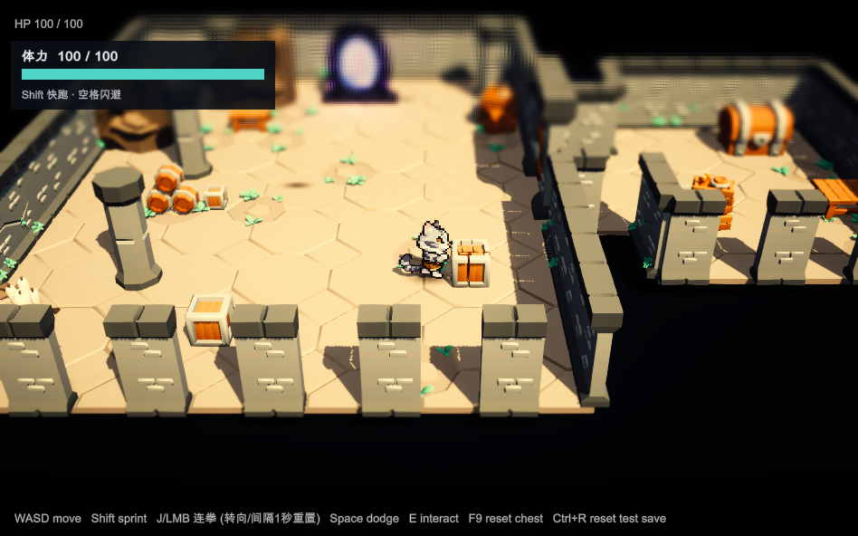
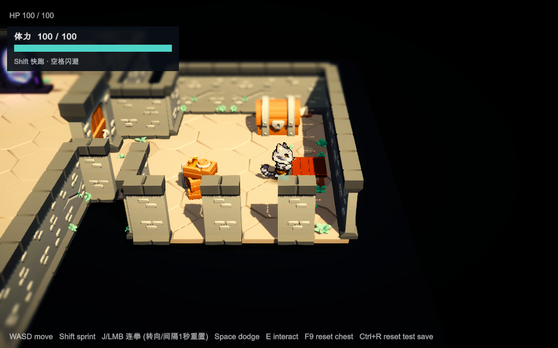

# KayKit 木箱、桌子破坏与怪物推挤修正

2026-11-10，Unity 6000.3.16f1，当前场景 `Assets/Scenes/Region_KayKit.unity`。

## 已实现

- 敌人追击在物理模拟前检测角色接触，限制朝角色内部的速度；同时阻止敌人互相顶入后传递推力。
- 普通木箱 / 补给箱 / 桌子共 6 组接入 `IDamageable`，使用现有 J / 鼠标攻击与 Hitbox 去重机制。
- 首次非致命命中换为有裂隙的预切网格并轻微摇动；生命归零后木片按攻击方向散落，1.8 秒后收缩清理。
- 完整物体保留 2D 阻挡，碎片没有 Rigidbody 或 Collider；破坏后撤掉物体全部 Collider2D。
- 破坏状态按区域和稳定 `propId` 保存；重载不恢复已破坏物体，也不再次播放碎片。
- 带奖励的宝箱仍只通过 E 开启，没有接入攻击破坏，普通破坏不发放宝箱金币。

## 素材与制作

使用免费的 [OpenFracture](https://github.com/dgreenheck/OpenFracture) MIT 切割 / 三角化算法，仅纳入编辑器工具部分，固定提交和源码哈希见 `Assets/Editor/KayKitFractureGeometry/SOURCE.json`。没有安装或购买完整破坏插件。

从 KayKit 原网格拆出独立构件，再预切保留 UV 的碎片：普通木箱 10 片，补给箱 22 片，桌子 16 片。原贴图继续使用，断口使用木色材质。游戏运行时不进行网格切割。

更多离线与商业方案见 [调研笔记](KayKit_Destruction_Research.md)，包括 Blender Cell Fracture、OpenFracture、DinoFracture 和 RayFire 2。

`Layout.json` 的变体字段 `destructible` / `maxHealth` 控制类型，摆放字段 `id` 用于保存状态。当前单木箱 20 HP，补给箱和桌子 30 HP。

菜单 `工具/角色扮演/KayKit/4. 接入木箱与桌子破坏` 会更新当前已保存的 KayKit 场景和对应 Prefab，保留角色、宝箱、门和布局。原搭建菜单也支持新字段，后续重新生成不会丢掉破坏行为。

## 已验证

原推挤复现：主角站立且无敌，关闭怪物攻击，只保留追击。修正前 1 秒偏移 **1.1724**，修正后同样场景偏移 **0.0000**。

真实 Play 共 **52 PASS / 0 FAIL**，完整输出见 [验证记录](KayKit_Preview/Destruction/validation.txt)：

- 八方向追击不推走主角，主角可以离开接触；四只敌人同时追击不挤走主角。
- 实际虚拟键盘 J 输入与生产 Hitbox，对同一物体的多个碰撞体只扣血一次。
- 受损外观仍阻挡；归零后移除所有阻挡，主角可走过木箱原占地。
- 木片生成、散落状态和限时清理；普通破坏不发金币。
- 重载后破坏状态保留，宝箱 E 交互与金币奖励继续工作。

这些验证发生在另一个会话后续朝向修改之前；最终整合后的检查需要等该会话释放 Unity。没有目标设备性能测量。

## 待编辑器释放后的收尾

用户确认另一个会话仍在使用 Unity，且它在修改 `GoblinWarriorSetup.cs`、`DirectionalEnemyView.cs`、`Hd2dPixelPlayer.cs` 与哥布林 Prefab。保留其改动，当前不再切换 Play。

1. 等其明确释放编辑器后，重新核对编译与现场，补齐实际游戏帧的碎裂动画预览。首次录制被共享编辑器重载打断；只有完整 / 裂缝阶段的有效截图，不能当作完整动画。
2. 删除本任务临时导入的 `Assets/Editor/EnemyPushRegression.cs` 和 `Assets/Editor/KayKitDestructionRegression.cs` 及其 `.meta`，来源保留在 `Tools/Tests/`。
3. 在游戏停止写存档后，核对并恢复本任务的存档 / `.bak` 基线。若另一会话使用了同一路径，先协调双方测试存档，不能覆盖它的待恢复状态。
4. 再核对场景与本任务源码、最终 Console，保持未提交 / 未推送。

本任务现场与存档基线在 `/var/folders/dz/x7t36nk1445c4l8wbxt05vgr0000gn/T/kaykit-destruction-baseline-ulw3cngd/`：`hashes.json`、`status.txt`、`saves.json` 及原始两份存档。运行记录 / 截图在 `/tmp/kaykit-destruction/`。基线存档禁止在另一个会话仍写入时直接覆盖回去。

## 已采集画面

