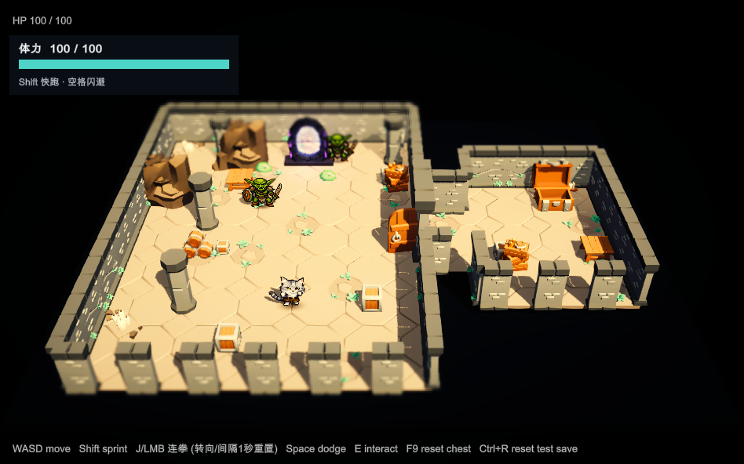
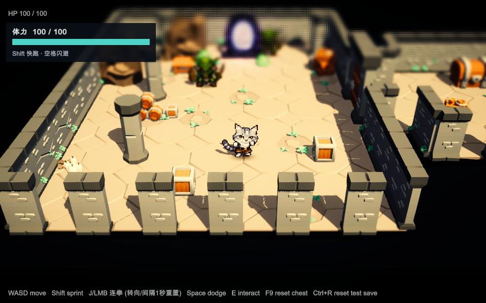
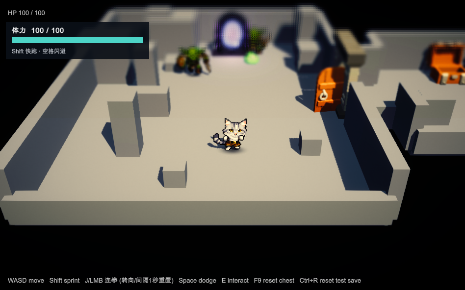
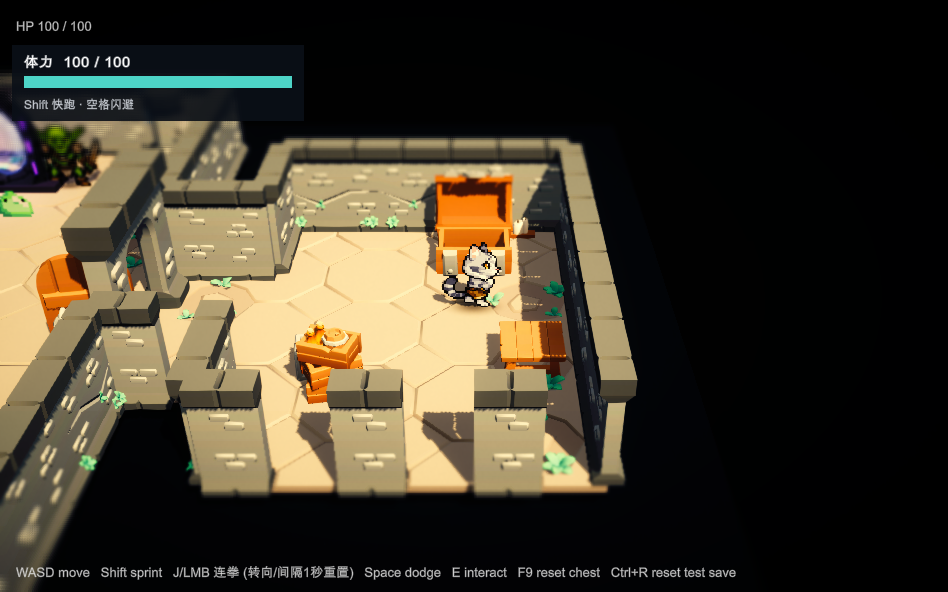

# KayKit 遗迹庭院样板

2026-11-10。Unity 工程：`/Users/lexinshengwen/SurvivorLikeGame/SurvivorLikeGame`。

打开 `Assets/Scenes/Region_KayKit.unity` 并进入 Play。当前编辑器已打开该场景。
WASD 移动，Shift 快跑，空格闪避，E 开门 / 开箱。北侧裂隙沿用原有幸存者子玩法，结束后返回本区域。

## 本次内容

- 主庭院、通道、宝箱侧室：62 个 2m 网格地面单元，地面连通。
- 34 个 KayKit Unity FBX 与一张 atlas，来自免费 1.1 包，CC0。原许可证与源文件清单位于 `Assets/Art/KayKitDungeon/`。
- 8 种可复用道具 Prefab、14 个摆放实例；其中装饰柱、补给堆组合了额外旗帜 / 木箱。
- 灰盒和正式模块共用 58 个 Collider2D。道具的碰撞按放置、旋转后的实际 XZ 包围盒映射到 XY。
- 侧室门沿作者的门板合页打开，动画结束后放行，按区域保存开启状态。
- 宝箱沿用现有 Chest / ChestView：独立箱盖、10 金币、0 经验、不重复领取。本样板没有装备掉落。
- 像素角色、战斗、相机、原有传送门表现从当前 Region_Test 复制；原场景和现有控制脚本保留。

## 可重复制作流程

1. 修改 `Assets/Art/KayKitDungeon/Layout.json`：房间采用整数网格坐标；道具位置采用游戏 XY 世界坐标。`seed` 固定地砖与墙体选择。
2. 在 `variants` 中选择模型、缩放和可选的 `detailModel` / `detailOffset` / `detailScale`；在 `props` 中设置位置和旋转。组合使用包内模型，不调用外部收费生成接口。
3. 运行菜单 `工具/角色扮演/KayKit/1. 构建模块样板`。搭建器会检查地面连通、变体 id 和位置，再生成 Prefab、碰撞、区域资产及场景。
4. 用 `工具/角色扮演/KayKit/2. 构建灰盒样板` 检查空间，或 `3. 切换灰盒与模块` 比较同一布局。交互对象与角色在两种模式下共用。
5. 在实际游戏镜头里检查人物比例、通路和遮挡，再进入 Play 验证。完整生成摘要位于 `Assets/Art/KayKitDungeon/Generated/BuildReport.json`。

构建命令会重建新样板中的布局和交互对象；手工调整若要保留，应写回 Layout.json 或另存场景。当前场景有未保存修改或处于 Play 时，构建器会停止。首次从 Region_Test 复制角色与相机，后续重建只处理 KayKit 样板。

本样板保持平面动作玩法；门、墙和道具使用 2D 碰撞，模型显示在 3D 平面。没有新增高低差移动或敌人绕墙导航；敌人沿用现有直线追击，用来观察角色与环境的搭配。

## 验证结果

最终修改经过真实 Unity Play，25 PASS / 0 FAIL：

- 入口出生、区域模式识别、地面高度与 XY / XZ 对齐。
- 用虚拟键盘驱动现有 PlayerMotor，验证边界、木箱、关门阻挡及离开接触。
- 通过 WorldInteractor 与 E 输入开门，验证开门动画、通行与区域状态。
- E 开箱、箱盖向上开启、金币准确发放一次、重载保持状态。
- 实际进入幸存者裂隙并返回 Region_KayKit。

灰盒另在 Play 中检查画面。截图来自实际游戏帧；鸟瞰图只在测试运行时临时改变相机，未写回跟随相机设置。
未做目标设备性能验收。Unity Metal 渲染时出现已有的 memoryless depth load/store 提示；最终脚本编译与 Console error 检查为零错误。

测试期间用过的 Assets/Editor 临时验证脚本已移除；复用来源在 `Tools/Tests/KayKitSceneRegression.cs`。
原存档 `rpg_save_0.json` 与 `.bak` 在退出 Play 后恢复，并核对 SHA-256。没有提交或推送。

## 预览

